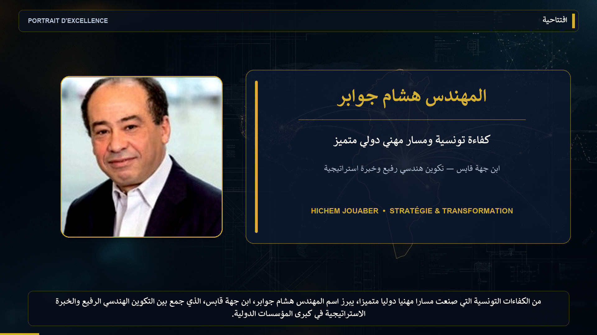
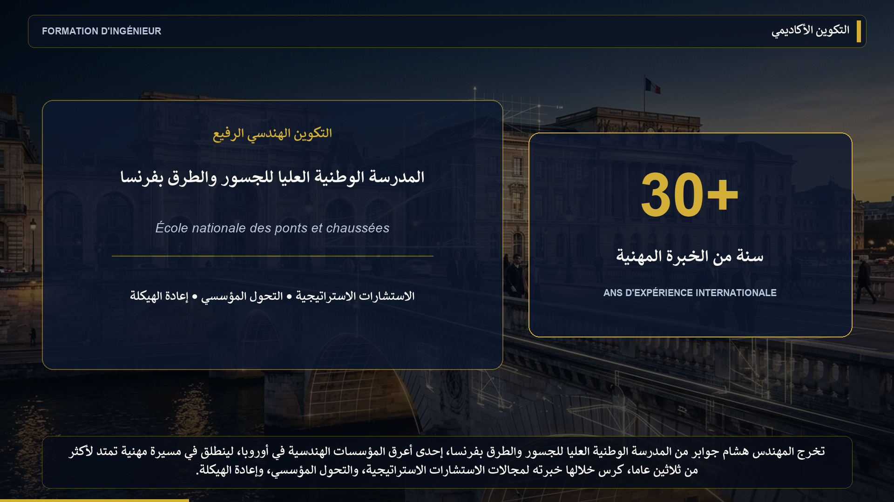
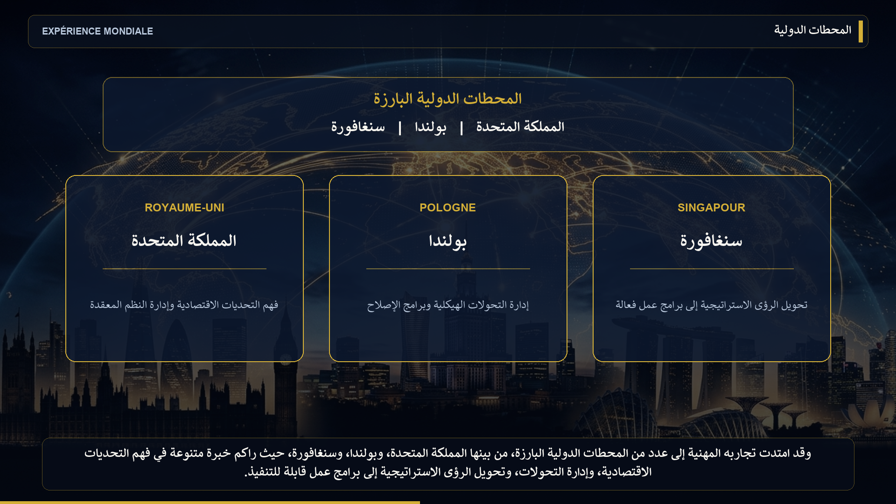
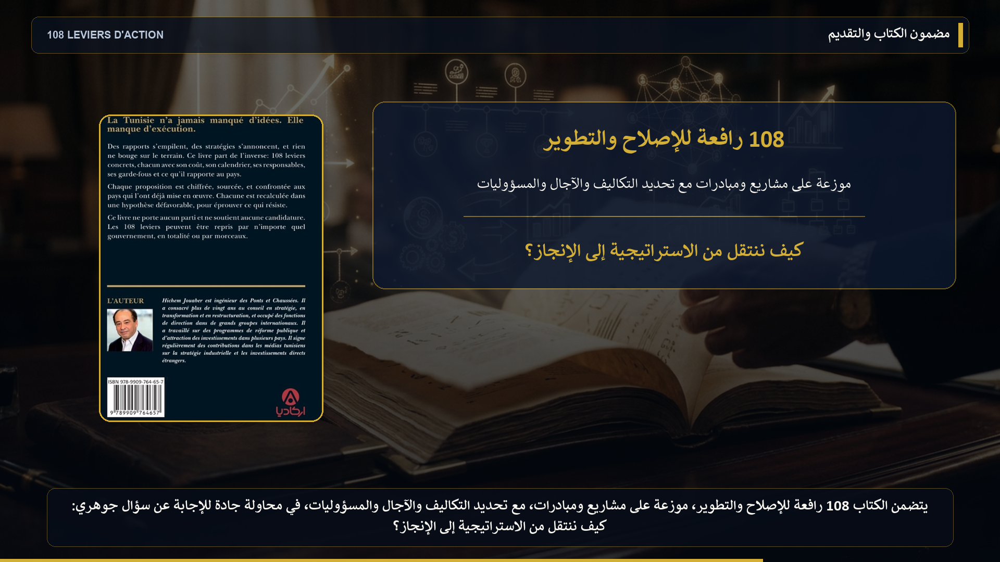
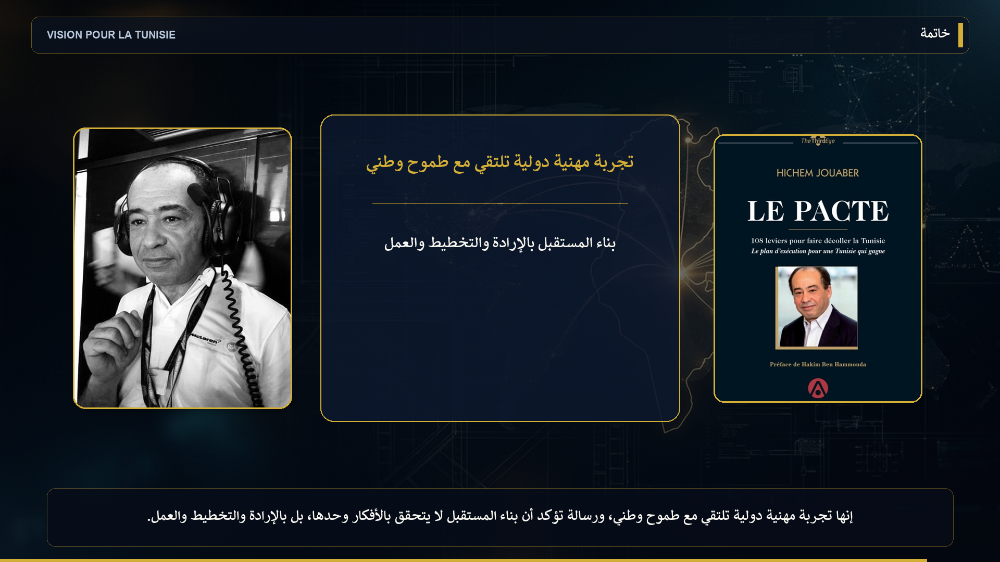

# Arabic/French Documentary Video Generator (`docvideo`)

A modular, config-driven Python toolkit for generating Full HD (1920×1080 @ 24 fps) bilingual (Arabic RTL + French/English LTR) documentary videos from a single JSON project specification—combining **Edge-TTS Arabic voiceover**, **cross-lingual phonetic splicing**, **procedural documentary background music** with smooth ducking, **Ken Burns motion**, **timed glassmorphic cards**, **synchronized Arabic subtitles**, and **FFmpeg pipe encoding**.

The included reference project ([examples/hichem_jouaber/project.json](examples/hichem_jouaber/project.json)) reproduces the 1:59 documentary profile for **Eng. Hichem Jouaber** and his book *«الميثاق – 108 رافعة لإقلاع تونس» (LE PACTE)*.

---

## Sample Output Gallery (`examples/hichem_jouaber/sample/`)

Ready-to-inspect rendered outputs are included directly in the repository:

| Output | Direct Browser Player (`raw.githubusercontent.com`) | Repository File |
| :--- | :--- | :--- |
| **Full 1080p Documentary Video (1:59, 26.7 MB H.264/AAC)** | [▶ Play Video in Browser](https://raw.githubusercontent.com/medboughrara/Arabic-French-Documentary-Video-Generator/main/examples/hichem_jouaber/sample/hichem_jouaber_intro.mp4) | [`hichem_jouaber_intro.mp4`](examples/hichem_jouaber/sample/hichem_jouaber_intro.mp4) |
| **Mixed Master Soundtrack (Voiceover + Ducking Score, 2.7 MB)** | [🔊 Play Audio in Browser](https://raw.githubusercontent.com/medboughrara/Arabic-French-Documentary-Video-Generator/main/examples/hichem_jouaber/sample/master_audio.mp3) | [`master_audio.mp3`](examples/hichem_jouaber/sample/master_audio.mp3) |
| **Scene 1 Phonetic Splice (`ar-SA-HamedNeural` + `ar-EG-ShakirNeural` `"جَابِسْ"`, 0.3 MB)** | [🔊 Play Scene 1 Audio](https://raw.githubusercontent.com/medboughrara/Arabic-French-Documentary-Video-Generator/main/examples/hichem_jouaber/sample/scene1_voiceover.mp3) · [▶ Audio Card MP4](https://raw.githubusercontent.com/medboughrara/Arabic-French-Documentary-Video-Generator/main/examples/hichem_jouaber/sample/scene1_voiceover_card.mp4) | [`scene1_voiceover.mp3`](examples/hichem_jouaber/sample/scene1_voiceover.mp3) |

> **Note on Playing Audio Directly Inside GitHub `README.md`**: GitHub's Markdown sanitizer strips `<audio>` and `<video>` HTML tags pointed at repo files. Use the direct `raw.githubusercontent.com` links above to stream audio/video straight in your browser tab, enable **GitHub Pages** from `/docs` ([docs/index.html](docs/index.html)) for an embedded HTML5 player, or drag-and-drop [`scene1_voiceover_card.mp4`](examples/hichem_jouaber/sample/scene1_voiceover_card.mp4) / [`hichem_jouaber_intro.mp4`](examples/hichem_jouaber/sample/hichem_jouaber_intro.mp4) into the GitHub README/Issue editor to generate a native `github.com/user-attachments/assets/...` inline player.

| Scene 1 — Intro | Scene 2 — Academic |
| :---: | :---: |
|  |  |

| Scene 4 — International Hubs | Scene 6 — Book & Preface |
| :---: | :---: |
|  |  |

| Scene 7 — Closing | |
| :---: | :---: |
|  | |

---

## Future R&D Roadmap: Native Tunisian Derja Speech & Understanding
See [docs/TUNISIAN_DERJA_ROADMAP.md](docs/TUNISIAN_DERJA_ROADMAP.md) for the multi-phase architecture, Tunisian open-source datasets (`TunSwitch`, `TuniSpeech-21h`, `TARIC`, `linagora/Tunisian_Derja_Dataset`, `TUNIZI`, `TunArTTS`), and tooling plan to build a full Derja understanding and speaking AI model.

---

## Architecture

```text
c:\Users\Lenovo\Music\video
├── docvideo/
│   ├── __init__.py          # Package metadata
│   ├── audio_tts.py         # Edge-TTS synthesis, cross-lingual part splicing & ASR check
│   ├── music_synth.py       # Procedural Dm9-Bbmaj7-Fmaj7-Cadd9 score + smooth ducking
│   ├── text_renderer.py     # Arabic shaping/BiDi cache, LTR typography, header & subtitles
│   └── video_renderer.py    # Ken Burns backgrounds, framed sprites, timed cards & FFmpeg pipe
├── scripts/
│   ├── crop_assets.py       # Export cropped portrait & book-cover sprites for inspection
│   └── test_pronunciation.py# Audition Edge-TTS diacritics / splices & run ASR check
├── examples/
│   └── hichem_jouaber/
│       └── project.json     # Full 119s, 7-scene documentary specification
├── assets/                  # Source photography, illustrations & local fallback fonts
├── generate_video.py        # Main CLI entrypoint
├── requirements.txt         # Pinned Python dependencies
└── .gitignore
```

---

## Workstation Environment (Tested Reference Setup)

This tool was built and verified on the following environment:

| Component | Verified Version / Details |
| :--- | :--- |
| **OS** | Windows (`win32`, PowerShell) |
| **Python** | `3.9.0` |
| **`Pillow`** | `10.4.0` (uses Windows TrueType fonts with `arabic-reshaper` + `python-bidi`) |
| **`numpy`** | `1.21.2` |
| **`edge-tts`** | `7.3.1` |
| **`aiohttp`** | `3.9.5` *(pinned: newer `aiohttp >= 3.11` raises `TypeError` on Python 3.9.0 with `edge-tts`)* |
| **`arabic-reshaper`** | `3.0.0` |
| **`python-bidi`** | `0.6.11` |
| **`pydub`** | `0.25.1` |
| **`SpeechRecognition`** | `3.17.0` (optional pronunciation QA helper) |
| **FFmpeg** | CLI binary in `PATH` (tested with `N-55702-g920046a`, supports `-strict -2` AAC + `width_type=q` equalizer) |
| **System Fonts** | `C:/Windows/Fonts/calibrib.ttf`, `calibri.ttf`, `arialbd.ttf`, `arial.ttf`, `ariali.ttf` |

### Important Implementation Notes for Windows
1. **FFmpeg Deadlock Prevention**: Streaming raw RGB24 frames via `subprocess.Popen` with `stderr=subprocess.PIPE` deadlocks on Windows once FFmpeg fills the ~64 KB pipe buffer. `docvideo/video_renderer.py` redirects FFmpeg `stderr` to a `.ffmpeg.log` file instead.
2. **Legacy FFmpeg Compatibility**:
   - Audio encoding uses `-c:a aac -strict -2 -b:a 192k` so both older and modern FFmpeg builds succeed.
   - Equalizer filter uses `width_type=q` (`equalizer=f=160:width_type=q:w=1:g=3.0`).
3. **Arabic Font Shaping (`raqm=False`)**: Google variable fonts such as `Tajawal-Bold.ttf` may lack isolated Arabic Presentation Forms-B glyphs when rendered without HarfBuzz/raqm. Windows `calibrib.ttf` / `calibri.ttf` (paired with `arabic-reshaper` + `python-bidi`) render all connected ligatures cleanly.
4. **Edge-TTS Dialectal Hard-`/g/` Phonetic Splicing**: For Tunisian proper nouns requiring hard `/g/` in pure Arabic speech (e.g., *Gabès / قابس* pronounced `/gaːbɪs/` rather than `/qaːbɪs/`), `audio_tts.py` supports splitting a cue into `parts`, synthesizing the token with `ar-EG-ShakirNeural` (`"جَابِسْ"`, where Egyptian `ج` is hard `/g/`), normalizing volume (`volume=0.82`), trimming silence, and stitching seamlessly into the `ar-SA-HamedNeural` narration.

---

## Quick Start

### 1. Install Dependencies
```powershell
python -m pip install -r requirements.txt
```
Ensure `ffmpeg` is available on your `PATH`:
```powershell
ffmpeg -version
```

### 2. Render Scene Previews First (Recommended)
```powershell
python generate_video.py --project examples/hichem_jouaber/project.json --previews-only
```
This builds or reuses the audio track and exports one PNG preview frame per scene into `assets/previews/` in a few seconds.

### 3. Render the Full 1080p Video
```powershell
python generate_video.py --project examples/hichem_jouaber/project.json
```
Useful flags:
- `--rebuild-audio` — Force re-synthesis of all TTS segments and re-mix of `master_audio.wav`.
- `--audio-only` — Only build TTS cues and the ducked master soundtrack (`assets/audio/master_audio.wav` & `.mp3`).
- `--output my_video.mp4` — Override the output MP4 path.

### 4. Helper Utilities
- **Inspect / export image crops**:
  ```powershell
  python scripts/crop_assets.py --source assets/ilboursa_img.jpg --out-dir assets/crops
  ```
- **Test Arabic diacritics & ASR transcript check**:
  ```powershell
  python scripts/test_pronunciation.py "المُهَنْدِسُ هِشَام جْوَابِر"
  ```

---

## Creating Your Own Video Project

1. Duplicate `examples/hichem_jouaber/project.json` to e.g. `projects/my_video/project.json`.
2. Add your background images and portrait/product photos under `assets/`.
3. Define:
   - `video`: `width`, `height`, `fps`, `duration`, `crossfade_sec`.
   - `assets.backgrounds` & `assets.sprites`: image paths, optional `crop: [x0, y0, x1, y1]`, `size`, and color grading.
   - `audio_cues`: timestamped narration lines (`tts_text`, display `subtitle`, or `parts` for custom phonetic splices).
   - `scenes`: `start`/`end` timestamps, `ken_burns` pan/zoom parameters, and declarative `elements` (`sprite`, `rect`, `line`, `text_ar`, `text_ltr`, each with optional `start_offset` / `end_offset`).
4. Run preview check (`--previews-only`), then full encode!

---

## Repository

Remote origin is configured for [Arabic-French-Documentary-Video-Generator](https://github.com/medboughrara/Arabic-French-Documentary-Video-Generator), with large generated media (`*.mp4`, `*.wav`, `*.mp3`, `assets/previews/`, `assets/crops/`, `assets/audio/`) excluded by `.gitignore`:

```powershell
git clone https://github.com/medboughrara/Arabic-French-Documentary-Video-Generator.git
```

